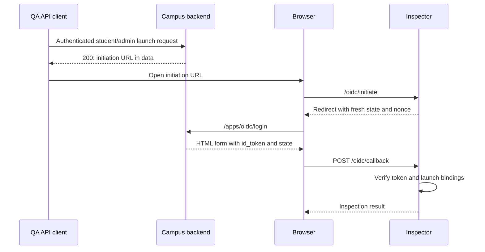

# Campus Inspector: QA launch guide

Use Postman or another API client to request a Campus launch, then complete it in a browser and review the backend’s identity token in the inspector.

## 1. Prepare the inspector

1. Open the inspector's public HTTPS URL and sign in with the operator password.
2. In **App setup**, copy the registration JSON. Have an authorized administrator submit it to `POST /admin/campus-apps` in the test environment.
3. Check that the registered URLs point to this inspector:

   | Registration field | Inspector URL |
   | --- | --- |
   | `oidc_initiation_url` | `<INSPECTOR_URL>/oidc/initiate` |
   | `jwks_url` | `<INSPECTOR_URL>/.well-known/jwks.json` |
   | `launch_url` and an entry in `redirect_uris` | `<INSPECTOR_URL>/oidc/callback` |

4. Save a named profile with the **Campus request base**, **Expected issuer**, returned **Client ID**, and **Installation ID**. In **Saved apps**, select **Use profile**.

Reuse an existing registration if available. Copy the issuer and installation ID exactly. Keep the numeric `app_id` for launch requests; it is different from the client and installation IDs.

## 2. Start a student or admin launch

Call the appropriate endpoint against the selected environment's Campus request base:

| Launch | Request | Authentication |
| --- | --- | --- |
| Student | `GET /students/campus-apps/{appId}/launch` | Direct student bearer token or student session cookie |
| Admin | `GET /admin/campus-apps/{appId}/launch` | Direct admin session with system-scoped `campus_apps.app.read` |

Use an active user in the installation’s tenant and an active app/installation. Student launch needs no RBAC grant. Impersonation is rejected.

Expect **HTTP 200** with an initiation URL in `data`. Open it in your browser within **five minutes**. Each URL is single-use; obtain a fresh one for every attempt. The normal flow needs no manual user ID/reference entry.

## 3. Follow the OIDC flow

Postman does not execute the HTML form-post; complete this step in a browser. If prompted, sign in to view the inspection.

## 4. Review the result

Open the resulting **OIDC launch**, or select it from **Run history**. For a successful launch, expect **passed** and check:

- **Signature:** valid RS256 signature using Campus public keys.
- **Issuer, audience and authorized party:** correct environment and client.
- **State and nonce:** match the launch; token lifetime is five minutes.
- **Subject:** original student/admin user ID.
- **Context:** correct tenant/installation; roles are an array of strings (an empty array is valid).

**Passed** means required checks passed; **failed** means a validation failed; **blocked** means a prerequisite prevented verification. Check the technical claims too—a valid signature alone is insufficient.

Use **Request logs** or the run’s logs to inspect redacted initiation, callback and JWKS traffic. **Unobserved** means the inspector could not observe the browser response; it is not an HTTP status.

## 5. Check the ticket's negative cases

| Test condition | Expected backend result |
| --- | --- |
| Launch request without valid Campus authentication | 401 |
| Wrong platform session, impersonation, or admin without the required permission | 403 |
| Invalid/nonpositive app ID in the launch path | 400 |
| App not installed in the authenticated tenant | 404 |
| Disabled app/installation or ineligible user | 403 |
| OIDC request with expired or already-consumed launch reference | 400 on `login_message_hint` |
| OIDC request with a mismatched user, client, callback or target | 400 on the relevant field |
| Reused nonce for the same app while the first token is still valid | 400 on `nonce` |

For nonce replay, use **Launch inspector** with two fresh references and the same **Advanced · nonce replay QA** override. Supply each launch URL’s `login_hint` as the original user ID and `login_message_hint` as the reference.

Use genuinely expired/consumed references or revoked-access fixtures. Random invalid references do not prove those cases.

If Campus rejects before callback, the browser stays on its JSON error and no callback run is created. Capture that backend status and field error directly.

## 6. Attach useful evidence

Record the environment/profile, user type, expected/actual outcome, run ID and failing check or backend error. Attach **Run history → Export JSON** and a relevant redacted screenshot. Exports omit claims and full bodies. Never attach raw tokens, passwords, initiation URLs or references.
